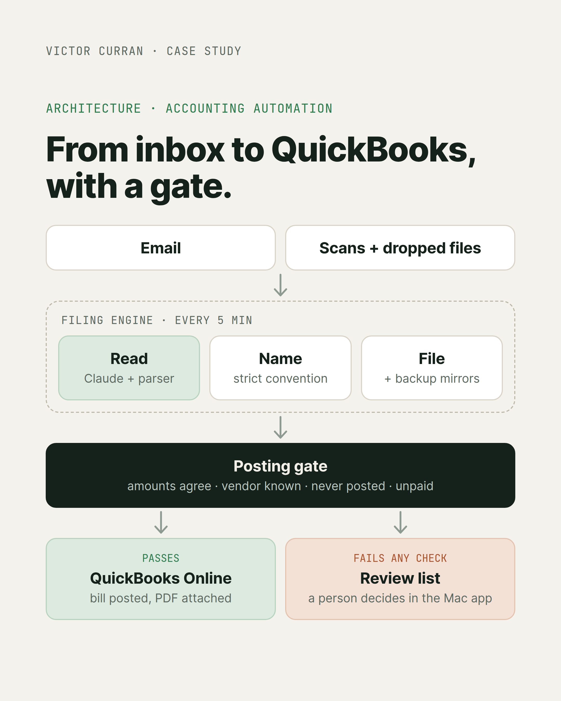
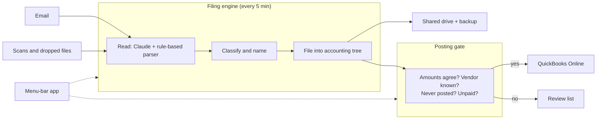
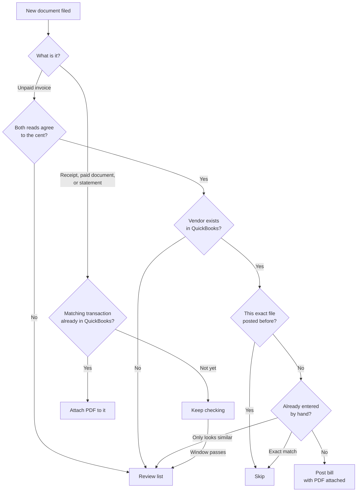

# Accounting Automation Pipeline: Vendor Bills From Inbox to QuickBooks, Unattended

*Built for [Settlemyre Nursery](https://settlemyrenursery.com), a family-owned garden center and landscaping business.*

**Role:** Sole engineer (design, build, deployment, support)

**Engine:** Python, scheduled every 5 minutes with launchd

**Document reading:** Claude API, pdfplumber, PyMuPDF, OCRmyPDF + Tesseract for scanned paper, ReportLab for rendering emails to PDF

**Integrations:** QuickBooks Online API (OAuth 2.0), email over IMAP and SMTP

**Mac app:** Swift, SwiftUI menu-bar app, signed and notarized installer built with GitHub Actions

**Status:** In production

> This is a case study, not the source code. The production repo is private and belongs to Settlemyre Nursery.

---

  

<!-- SCREENSHOT: The menu-bar app panel open on a normal day. Hide or blur vendor names, amounts, and file names.

  

-->

## Overview

Every five minutes, this pipeline collects vendor bills and receipts from email, scanned paper, and dropped-in files. It reads each one, renames it to a strict convention, files it into the accounting folder tree, mirrors it to shared and backup storage, and posts verified unpaid bills into QuickBooks Online with the PDF attached. People review and pay in QuickBooks. It handles hundreds of bills a month and runs the same engine for two companies.

## The problem

- **Bills arrive in every format imaginable.** Hundreds of vendor name spellings, scanned paper, picture-only letterheads, totals in different places on every invoice.
- **Accounting mistakes are expensive.** A misread amount or a bill posted twice is worse than a bill not posted at all.
- **The people using it don't use a terminal.** Whatever I built had to be run and trusted by someone who will never open one.

## Key decisions

### 1. Never trust a single reader

Every document is read twice by two independent methods: Claude reads it when it's filed, and a rule-based parser reads it again at posting time. A bill only posts automatically when both amounts agree to the cent. Any disagreement, or any missing read, sends it to a review list instead. In accounting, "I'm not sure" is a feature.

### 2. The filename is the backbone

Every filed document gets a name that encodes its date, category, vendor, invoice number, and payment method. It's readable by a person scanning a folder and parseable by every other part of the system. A document that already has a correct name is trusted and skips the reader entirely.

### 3. A file posts once, ever

Posted documents are tracked by content hash, not just invoice number, so a bill with no invoice number can't sneak through twice. That same thinking caught a real bug: when attaching a PDF failed, the run exited after creating the bill but before recording it, so the next cycle would post it again. Now the record is written first and attach failures are retried on their own.

### 4. Only unpaid bills become bills

Early on, a paid receipt posted as a bill would book the same charge twice: once as the bill, once from the bank feed. Now only unpaid invoices are posted. Receipts, paid documents, and statements are matched to the transaction that already exists in QuickBooks by amount, date, and payment account, and the PDF is attached to it. If no match shows up within a set window, it goes to review with the search spelled out.

### 5. A control panel built for the bookkeeper

A native macOS menu-bar app shows a green, yellow, or red leaf, and explains in plain language what filed, what posted, and what needs a person. Everything that used to need a terminal is a button:

- **Pause Posting** puts the system in watch-only mode: it keeps filing and shows exactly what it would post, without sending anything to QuickBooks.
- **Preview Posting** shows what the next run would do before it does it.
- **Confirm Amount** lets a person type the amount from the paper when the readers disagree.
- **Attach to It / Post as New** resolves a bill that looks like it might already be in QuickBooks.

<!-- SCREENSHOT: The review list with a bill waiting for a person, showing the Confirm Amount or Attach to It buttons. Blur vendor names and amounts.

  

-->

The app ships as a signed, notarized macOS installer built in GitHub Actions on Apple's cloud runners. The accounting machine has no repository access by design, so the installer is the only delivery channel, and every update preserves live data and settings.

## Problems worth telling

**Bills that were already there.** After posting had been paused for a while, a dry run listed a big batch of bills as new. Most of them had already been typed into QuickBooks by hand in the meantime. Now every run checks QuickBooks itself first, read-only, matching on invoice number and amount even when the number is written differently (INV-0012345 vs 12345). Anything that only *looks* like a match, like the same number with a different amount, is held for a person instead of guessed at.

**Alert fatigue.** The daily summary email went out every morning, and people stopped reading it. It now sends only when something actually needs a human, and stays silent on a quiet day. Fewer emails, more of them read.

**Storage that disappears.** Shared drives and backup volumes get unmounted. Every copy checks that the destination really exists first, and a sweep each cycle catches up on anything missed. One stubborn file used to stop the whole sweep at the same spot every time; now a single failure is skipped and logged.

**Reading real invoices.** Fixes driven by real feedback: never mistaking a subtotal for the total, reading picture-only letterheads, matching vendors by phone number, and never treating a field label as a vendor name.

## Architecture

### Zoom in: where every document ends up

Every path either ends in a safe automatic action or a person's review list. Nothing gets guessed at.

## Results

- Processes hundreds of bills a month, unattended, on a five-minute cycle for two companies
- Around 22,000 lines of Python and Swift, released through 50 versioned builds
- Offline test suites gate every release, covering routing, filing, posting, and the app's command layer
- Every posted bill carries its source PDF

<!-- Optional: hours of data entry saved per week, share of bills that post with no human touch. -->

## What I learned

Automation in accounting isn't about posting as much as possible. It's about knowing exactly when not to, and making that easy for a person to resolve. The other lesson: build for the person who will actually run it. Every terminal command I turned into a button made the system something the business could own without me.

---

**Victor Curran** · [GitHub](https://github.com/sn-Victor) · [LinkedIn](https://linkedin.com/in/victor-curran)
